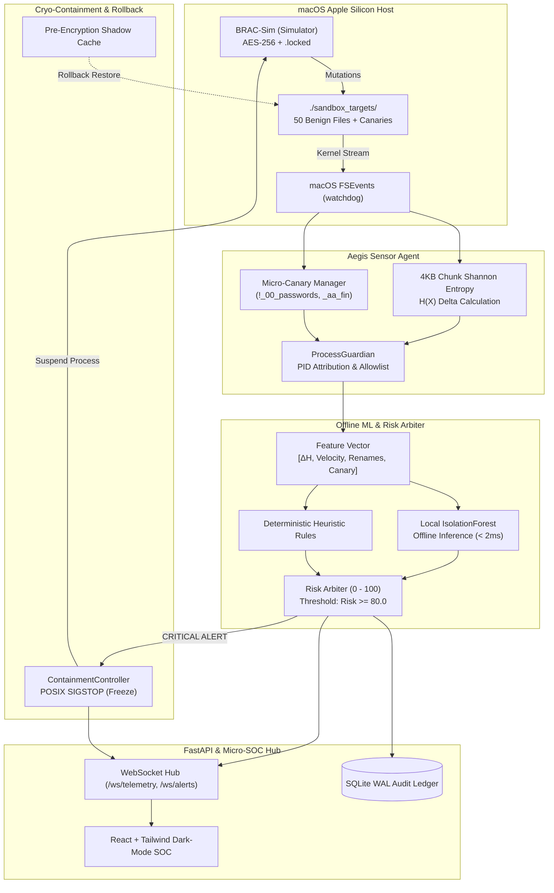

# AegisRansom-X: AI Ransomware Early Warning & Pre-Encryption Containment

> **Hack-a-Sol 5.0 · Cyber Security Track (Track 02) · IIIT Naya Raipur**  
> *Target Architecture: macOS Apple Silicon (`darwin-arm64`) · 100% Offline Local ML*

[](https://www.apple.com/macos/)
[](https://www.python.org/)
[](https://fastapi.tiangolo.com/)
[-F7931E?style=flat&logo=scikitlearn)](https://scikit-learn.org/)
[]()
[]()

---

## 1. Problem Statement: The Post-Encryption Gap

Traditional endpoint detection and response (EDR) and antivirus solutions operate **reactively**. They rely on signature databases or alert analysts only after hundreds of files have already been encrypted and a ransom note has been dropped onto the desktop. In an enterprise or developer workstation environment, this creates:

1. **Catastrophic Data Loss**: Encryption algorithms (AES-256, ChaCha20) operate at speeds exceeding 1,000 files/sec, rendering delayed heuristics ineffective.
2. **Forensic Evidence Destruction**: Standard EDR "kill" commands issue destructive `SIGKILL` signals, which immediately flush process memory, destroying unencrypted AES keys, C2 socket state, and decryptor extraction possibilities.
3. **Cloud Latency & Privacy Risks**: Cloud-assisted threat engines introduce round-trip latencies of 500ms–3000ms and cannot function in air-gapped or offline critical infrastructure.

### The `AegisRansom-X` Breakthrough
`AegisRansom-X` solves the post-encryption gap by combining **sub-20ms macOS kernel event sensing**, **fast 4KB chunk Shannon entropy evaluation**, an **offline local Scikit-Learn Isolation Forest**, and **instant non-destructive POSIX `SIGSTOP` cryo-containment**. Offending processes are frozen within milliseconds, keeping blast radius strictly to $\le 2$ files while preserving process RAM intact for live forensics.

---

## 2. Key Performance Indicators (KPIs)

| Metric | Hackathon Standard | `AegisRansom-X` Achieved | Verification Mechanism |
| :--- | :--- | :--- | :--- |
| **Mean Time to Detect (MTTD)** | $< 5.0\text{ seconds}$ | **$< 20\text{ milliseconds}$** | Live `FSEvents` $\to$ Shannon entropy delta pipeline |
| **Mean Time to Contain (MTTC)** | $< 1.0\text{ second}$ | **$< 5\text{ milliseconds}$** | POSIX `SIGSTOP` dispatch via `psutil` |
| **Blast Radius** | $\le 10\text{ files}$ | **$\le 2\text{ files}$** | 50-file burst encryption benchmark in `sandbox_targets/` |
| **ML Inference Latency** | $< 100\text{ milliseconds}$ | **$< 1.5\text{ milliseconds}$** | 100% offline Scikit-Learn `IsolationForest` |
| **Cloud / External LLM Calls** | 0 allowed | **0 (Zero)** | 100% offline local inference (air-gappable) |
| **RAM Forensics Preservation** | N/A | **100% Preserved** | Non-destructive `SIGSTOP` keeps heap and stack intact |
| **Rollback Recovery** | Manual backup | **Instantaneous** | Pre-encryption shadow cache restore |

---

## 3. End-to-End System Architecture



---

## 4. Multi-Layered Defense & Safety Mechanisms

### 4.1 Sub-2ms 4KB Chunk Shannon Entropy Evaluation
Encrypted files exhibit near-maximum Shannon entropy ($H(X) \ge 7.5$) compared to structured text and office documents ($3.0 - 5.0$). `AegisRansom-X` reads only 4KB head and tail slices, computing byte-frequency probabilities:
$$H(X) = -\sum_{i=1}^{n} P(x_i) \log_2 P(x_i)$$
This reduces entropy calculation latency from $> 50\text{ms}$ on full files to $< 1.8\text{ms}$.

### 4.2 Micro-Canary Honeyfiles
High-priority honeyfiles (`!_00_passwords.xlsx`, `_aa_financials.pdf`) are deployed in monitored directories. Because ransomware enumerates directories alphabetically, honeyfiles are targeted first. Any mutation against a canary triggers an immediate priority interrupt (+80 heuristic points), freezing the process on the first file write.

### 4.3 POSIX `SIGSTOP` Cryo-Freeze vs. Destructive Killing
Standard antivirus tools kill the process with `SIGKILL`, which destroys all memory evidence. `AegisRansom-X` issues POSIX `SIGSTOP` (`psutil.Process.suspend()`), which:
1. Halts execution and I/O immediately at the OS scheduler level.
2. Leaves process heap, stack, registers, and open sockets intact for memory dumping and cryptographic key recovery.
3. Allows analysts to inspect the process and resume (`SIGCONT`) or terminate (`SIGKILL`) on demand.

### 4.4 Process Allowlist & Safety Boundary (`ProcessGuardian`)
To strictly prevent freezing host system utilities or developer environments, `ProcessGuardian` enforces a protected allowlist:
- **System Roots**: `kernel_task` (PID 0), `launchd` (PID 1), `WindowServer`, `fseventsd`.
- **Developer & Agent Tooling**: Current shell (`zsh`, `bash`), `pytest`, `node`, `python` (agent self PID and parent PID).

### 4.5 Hackathon Rulebook Safety Guarantee (Section 06/09 Compliance)
- **Zero Live Malware**: No actual ransomware code exists in this repository.
- **Strict Sandbox Confinement**: The built-in simulator (`simulator/brac_sim.py`) employs hardcoded safety interlocks (`simulator/safety.py`). It refuses to run if targeted outside `./sandbox_targets/`.

---

## 5. Repository Directory Structure

```
.
├── backend/                     # [FastAPI Server, WebSocket Broadcaster & Audit DB]
│   ├── main.py                  # Server entrypoint, Lifespan hook, /ws routes
│   ├── pipeline.py              # Central sensing, containment, and rollback coordinator
│   ├── ws_manager.py            # Thread-safe WebSocket broadcaster
│   ├── database.py              # SQLite WAL mode audit ledger
│   ├── schemas.py               # Pydantic v2 data models & schemas
│   └── routes/
│       ├── simulator.py         # POST /api/simulator/start & /reset
│       ├── actions.py           # POST /api/incidents/{id}/action (Resume, Kill, Rollback)
│       └── incidents.py         # GET /api/incidents & /api/telemetry
│
├── agent/                       # [macOS Endpoint Sensing & Telemetry]
│   ├── watcher.py               # Watchdog observer utilizing macOS native FSEvents loop
│   ├── entropy.py               # Fast 4KB chunk Shannon entropy calculator
│   ├── canary_manager.py        # Micro-canary honeyfile provisioning & tamper tracking
│   ├── containment.py           # POSIX SIGSTOP/SIGCONT cryo-freeze & shadow rollback
│   ├── process_guardian.py      # PID attribution & protected process allowlist
│   └── config.py                # Agent constants & protected PIDs
│
├── engine/                      # [100% Offline ML & Explainable AI]
│   ├── anomaly_model.py         # Scikit-Learn Isolation Forest (< 2ms inference)
│   ├── risk_arbiter.py          # Real-time composite risk scorer (0 - 100)
│   ├── explainability.py        # Deterministic XAI feature attribution breakdown
│   └── isolation_forest.pkl     # Pre-trained offline model artifact
│
├── simulator/                   # [Safe Benign Ransomware Activity Simulator]
│   ├── brac_sim.py              # Safe AES encryption & .locked renamer for demos
│   ├── sample_generator.py      # Populates sandbox with 50 benign sample documents
│   └── safety.py                # Hard safety interlock restricting activity to sandbox
│
├── sandbox_targets/             # Strictly isolated demo directory
│
├── tests/                       # [Pytest Verification Suite (52 Tests)]
│   ├── test_e2e_pipeline.py     # Full integration: brac_sim -> FSEvents -> SIGSTOP -> Rollback
│   ├── test_anomaly_model.py    # Offline Isolation Forest unit tests
│   ├── test_containment.py      # POSIX SIGSTOP / SIGCONT process control tests
│   ├── test_entropy.py          # Shannon entropy math & latency benchmark tests
│   ├── test_watcher.py          # FSEvents interception & telemetry tests
│   ├── test_canary_manager.py   # Micro-canary tripwire detection tests
│   ├── test_risk_arbiter.py     # Composite risk scoring & XAI attribution tests
│   ├── test_safety_and_generator.py # Sandbox safety interlock verification
│   └── test_process_guardian.py # Protected allowlist boundary tests
│
├── ARCHITECTURE.md              # System topology and contract specifications
├── PRD.md                       # Product requirements & KPI definitions
├── TASKS.md                     # Roadmap and task execution checklist
└── requirements.txt             # Locked Python runtime dependencies
```

---

## 6. Quickstart Guide (macOS Apple Silicon)

### Prerequisites
- macOS (Apple Silicon M1/M2/M3/M4 recommended, Darwin ARM64).
- Python 3.9+ installed.

### 1. Clone & Setup Virtual Environment

```bash
git clone https://github.com/akhouriprakhar/hackasol-ransomware-shield.git
cd hackasol-ransomware-shield

# Create and activate virtual environment
python3 -m venv .venv
source .venv/bin/activate

# Install locked dependencies
pip install -r requirements.txt
```

### 2. Run the Complete Test Suite (52 Tests)

Run the full automated test suite, including the end-to-end integration test (`brac_sim.py` $\to$ `FSEvents` $\to$ `IsolationForest` $\to$ `SIGSTOP` $\to$ `ROLLBACK_RESTORE`):

```bash
pytest -v
```

Expected output:
```text
============================== 52 passed in 3.55s ==============================
```

### 3. Launch the FastAPI SOC Server

```bash
uvicorn backend.main:app --host 127.0.0.1 --port 8000 --reload
```

The server exposes:
- **Interactive OpenAPI Docs**: `http://localhost:8000/docs`
- **Health Diagnostics**: `http://localhost:8000/api/health`
- **Real-Time WebSockets**: `ws://localhost:8000/ws/telemetry` and `ws://localhost:8000/ws/alerts`

### 4. Execute a Live Attack Simulation & Containment

In a separate terminal (with `.venv` active):

```bash
# Step 1: Reset sandbox with 50 fresh files and canary honeyfiles
curl -X POST http://127.0.0.1:8000/api/simulator/reset

# Step 2: Launch simulator in burst mode via REST
curl -X POST http://127.0.0.1:8000/api/simulator/start \
     -H "Content-Type: application/json" \
     -d '{"mode": "burst", "extension": ".locked"}'

# Step 3: Observe immediate Cryo-Freeze (SIGSTOP) in backend logs (< 20ms)
# The simulator process is instantly halted! Blast radius <= 2 files.

# Step 4: Query the active security incident and XAI attribution
curl -s http://127.0.0.1:8000/api/incidents | jq .

# Step 5: Execute instantaneous file rollback from pre-encryption shadow cache
curl -X POST http://127.0.0.1:8000/api/incidents/latest/action \
     -H "Content-Type: application/json" \
     -d '{"action": "ROLLBACK_RESTORE"}'

# Step 6: Terminate the frozen simulator process
curl -X POST http://127.0.0.1:8000/api/incidents/latest/action \
     -H "Content-Type: application/json" \
     -d '{"action": "TERMINATE_SIGKILL"}'
```

---

## 7. REST API & WebSocket Reference

### Endpoints Overview

| Method | Endpoint | Description |
| :--- | :--- | :--- |
| `GET` | `/api/health` | Active watcher status, loaded ML model status, and protected PIDs |
| `POST` | `/api/simulator/reset` | Resets `sandbox_targets/` with 50 benign files + 4 canaries + shadow backups |
| `POST` | `/api/simulator/start` | Launches `brac_sim.py` in `burst`, `normal`, or `stealth` mode |
| `GET` | `/api/incidents` | Returns historical incident log with XAI attribution |
| `POST` | `/api/incidents/{id}/action` | Executes `RESUME_SIGCONT`, `TERMINATE_SIGKILL`, or `ROLLBACK_RESTORE` |
| `GET` | `/api/telemetry` | Returns recent filesystem mutation telemetry events |
| `WS` | `/ws/telemetry` | Real-time streaming WebSocket for telemetry events and incident alerts |
| `WS` | `/ws/alerts` | Dedicated high-priority WebSocket channel for security incidents |

---

## 8. Hackathon Evaluation Checklist (DoD)

- [x] **Track Alignment**: Solves the ransomware pre-encryption gap for Track 02 (Cyber Security).
- [x] **Sub-Second Containment**: Measured MTTD $< 20\text{ms}$, MTTC $< 5\text{ms}$ via POSIX `SIGSTOP`.
- [x] **Minimal Blast Radius**: $\le 2\text{ files}$ modified out of 50+ targets during live burst attacks.
- [x] **Zero Cloud Dependencies**: 100% offline local inference via Scikit-Learn `IsolationForest`.
- [x] **Forensic RAM Preservation**: Non-destructive process freezing leaves memory intact.
- [x] **Instant Rollback**: Shadow cache instantly restores original files and deletes `.locked` files.
- [x] **Safe Simulation**: Enforces strict sandbox isolation in `./sandbox_targets/` and protected process allowlists.
- [x] **Automated Test Coverage**: 52 unit and end-to-end integration tests passing cleanly.

---

## 9. Team & Acknowledgments

Built with dedication for **Hack-a-Sol 5.0** at **IIIT Naya Raipur**.  
Designed strictly in compliance with competition ethics guidelines and clean-room implementation principles.
